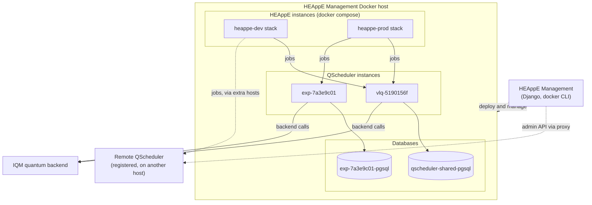
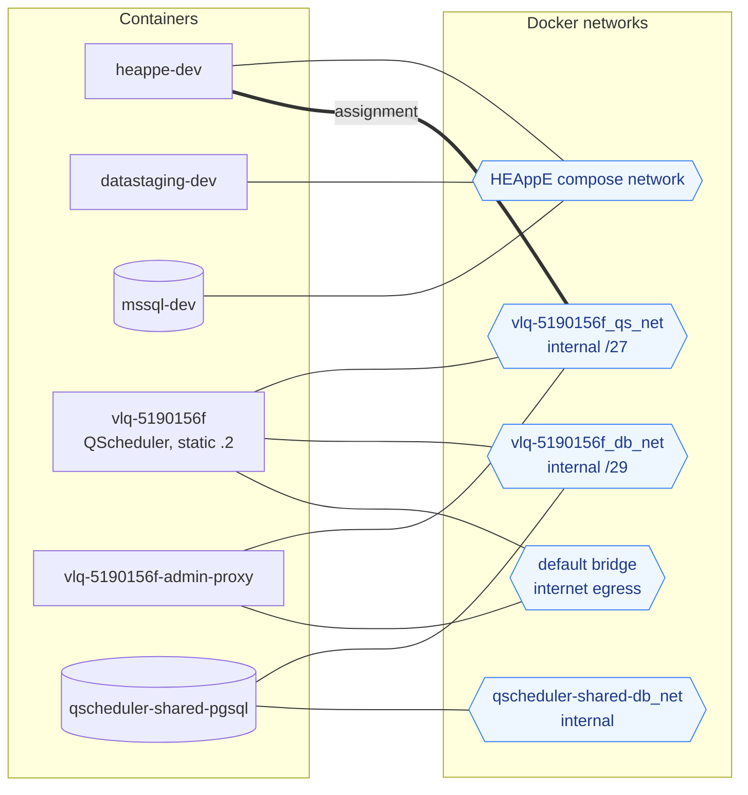
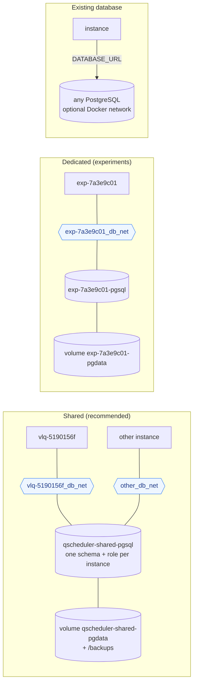
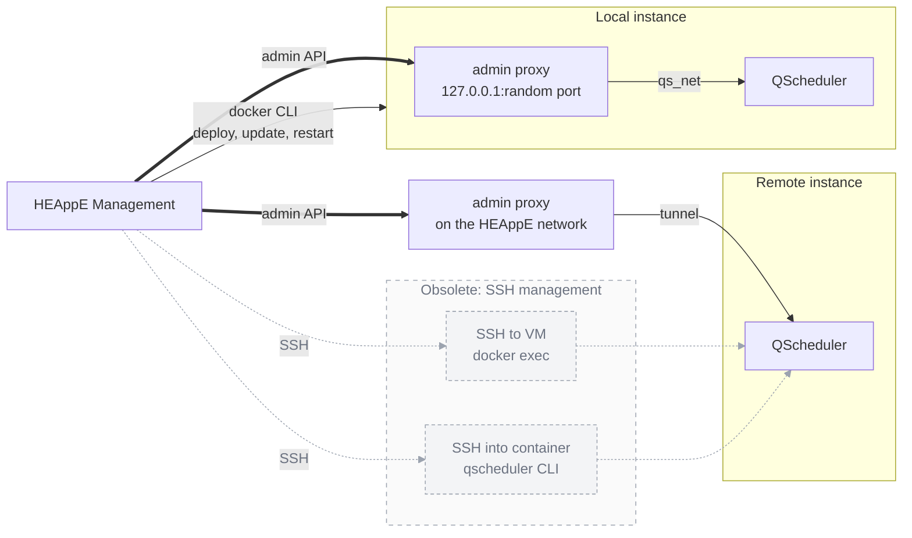
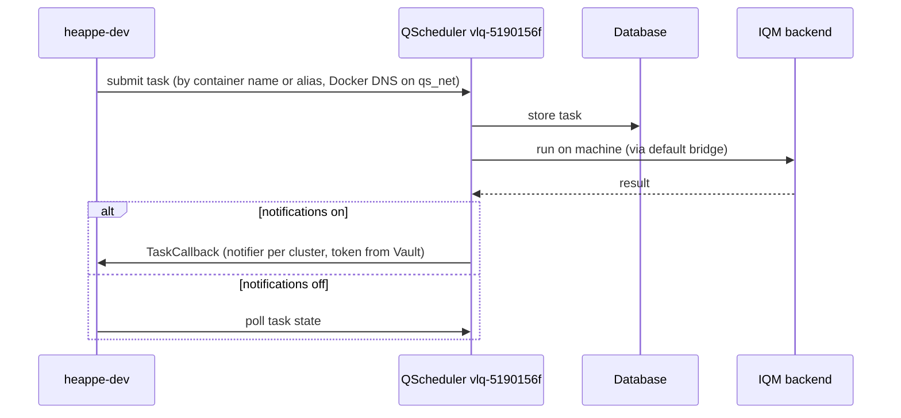

# Docker deployment: HEAppE and QScheduler

Containers, networks and volumes that HEAppE Management creates on its Docker host, plus registered remote
QScheduler instances. Each diagram answers one question; details are in
[QScheduler_README.md](QScheduler_README.md#qscheduler-network-and-aliases).

Example names used below: HEAppE instances `dev` and `prod`; QScheduler instances `vlq-5190156f` (shared database)
and `exp-7a3e9c01` (dedicated PostgreSQL).

- [1. Overview](#1-overview)
- [2. Networks of one local QScheduler instance](#2-networks-of-one-local-qscheduler-instance)
- [3. Database modes](#3-database-modes)
- [4. How HEAppE Management controls QScheduler](#4-how-heappe-management-controls-qscheduler)
- [5. Runtime traffic of a job](#5-runtime-traffic-of-a-job)
- [Notes](#notes)

---

## 1. Overview

What runs where, and who uses which QScheduler. A HEAppE instance can use several QScheduler instances, and a
QScheduler instance can serve several HEAppE instances.

[Open in Mermaid Live Editor](https://mermaid.live/edit#pako:eNqVlFFv2jAQx7_KyQ8TSGQrmrqp1VQJlgiQiggE7aXpg4kPkjaxQ-IwUNvvvnMSCBQehh-i6O5_P_99OeeNBUoguwe2jNXfIOSZhnnfl0BrPBjPn3w2dHpp6sCYS77CBKX-tci-PbTsFy5XqgNCBa-Ywe_HUdtnz76savNiscp4GsJw4l2EgF3VhSrXZR3US0QZBjpS8uDjlOf0XNdpiJHMNZcB5tCqnQQqSVWO7RPqKflxdpoZ2s4fQobI0xQtgRsgaPB6Rhi6s4ndCNNMiQtKlOKC8alHhVMvCFEUMdk8GL_C59TrEWQTr63b7t1N9_bH8qx46vVJgtvU-sm_411w0_0Pb7apsbnmC55fZchzB08tn63z_bGsnEYIhZWu8nXss_YnkjvoG_2xvUvSg8vypXqdOePJ3Hz4GSZKIzStrOYxw1WUa6TNO0BOuVQ6rOerGYXRdEwEesK64FIXCSzo65ldmtE1wwCW9fDusxe1oG68m77XOTMA1yX7x9Svh2QHNhEH3OqMlx5LdXXGqoCwhmVavA_0ywD1sFF82YcJWx8FAh7HJY7O2dzk_eYC01jtqD8CkvI2GqW5pedSLpJIQs8dlV5p2re7Y5esAyzBLOGRMD-QNwPwGXU9IeY9mK2WvIjpevvyw4h5oZW3kwEldVYgRYpUcI12xGkOkzr88Q_InVqV)

---

## 2. Networks of one local QScheduler instance

Each QScheduler instance gets its own networks. An assignment adds the `heappe` container to the QScheduler network.
Containers on the left, networks on the right.

[Open in Mermaid Live Editor](https://mermaid.live/edit#pako:eNqNk11v2jAUhv-KZW42KVkHVVmLxqTRoPWi6wLpRad6QiY-CRaJHWynH6L899kJHyF00nL5nvc5OX59vMaxZIAHCCeZfI4XVBl0OyUC2U-X81TRYoGuHwm-lsJQLkBpgv_UdfcxriA2XAp0PzqoN-PvYTi21AJoUYDP4OmICiJbY9RQbWjKRXpi-BlFk9vHDwTnWq-yuvyxUZ-4Bk_Zyr_oXn3uXvSTr3N19m0SxQtgZQbKQ7az4TH61DvqG05_PfxuoT5lORd-oeTL65E5Cn-4EVZ619XXNh9gfpHaoQ4DgWBEtCK7sz8JZLwEhQSYZ6mW_5Pb3ewmXK8JtvkVxRjFMi-khl0HgjebpncSOW_zKLOVnllzFQYXBpSgGTrrfWmTweiEZPP3yKs2GdXoaSbv8G12NHUog4SWmUFzxVkKDQAMglSB1geukWy9Usj3_SqlWgyillDtTUvbksPh8I1gqjVPRQ7CEPxWZVibJrtOO6HalJa2NwXbO7Mb8k8l2kl7ajQ9be20Wo0zO1sAibttlPAsG3QAkn6SeNoouYRB53x-2Uv6XiwzqQadLpzTS9pgqyN7blrPzeNVI3juF64lEdhDOAeVU87ce187lGCzgByIFfY3QzARG2empZHRq4ht0agSrFIW9tFCwKld8nwrb_4CWvVH9A)

The same as a table:

| Container | HEAppE compose net | `vlq-5190156f_qs_net` | `vlq-5190156f_db_net` | `qscheduler-shared-db_net` | `bridge` |
|---|:---:|:---:|:---:|:---:|:---:|
| `heappe-dev` | ✓ | ✓ (when assigned) | | | |
| `datastaging-dev`, `mssql-dev`, `sshagent-dev` | ✓ | | | | |
| `vlq-5190156f` (QScheduler) | | ✓ `.2` + aliases | ✓ | | ✓ |
| `vlq-5190156f-admin-proxy` | | ✓ | | | ✓ (publishes `127.0.0.1` port) |
| `qscheduler-shared-pgsql` | | | ✓ | ✓ | |

Address layout of `<name>_qs_net`:

| Address | Used by |
|---|---|
| `.1` | gateway |
| `.2` | QScheduler (static; kept by Update, token regeneration, DB migration, restarts) |
| lower half | reserved for static addresses |
| upper half | dynamic: HEAppE containers and the admin proxy |

---

## 3. Database modes

Chosen when an instance is deployed. In every mode, QScheduler reaches its database only through its own
`<name>_db_net`.

[Open in Mermaid Live Editor](https://mermaid.live/edit#pako:eNqNk21P4kAQx7_KprzRSKOlJ6fkYoJX4pEQgxQvl9gL2e5OoWG7W3a3PgT57jdbVIohF_uqnZn_PPxmuvaY4uD1iJcJ9cQWVFsymiSS4GOqdK5puSDxr_5kED0kXox-4ORIA1NFAZIDP068v9tw9_AcXTZXkkyvd9a7ALWPYuWfB5dnwXk3Qw3xfZ9EwXq975nxdCbBJt5m09B3UK_sAjTJpbFUMvjI0HEZat9BaRTUYfH45uEo8VaGLYBXArRv6lH8cm5W4keqT6-UBOLcBSUnRCsBpNyrd9wYM-q8Z93Z8GNr_O0qPSpRFUAOFeTU0rriCTlNKVtWpdllR6aJ_IQ_GkTDn_1pvYEIeM6odUuAZ2wwxy1Y86UlhChHjf-dhnDJzoIPhKFD2PQcJhnW0VuQzegtw31AbyzGTRafNA7D_-ce_BnG0-HtDfY9eM6NzeWcOFVKDXxl4G8o3L-Xq1ck2J_2r_vxYHY_GSXeK1aZuiapfCFjZexcQ3w32l5E6XJSQSLFlngLiORJ6eXBppmgxkSQuSCS5UL0WgBZN8vaxmq1hF4rTC86WbfNlFC61wogpBe0ocVLbUedNlJ25KXXJl4BuqA5dz_n2kUmHp55gaP08JVDRiuBO0rkxgXTyqr4RTJ0Wl0BWqoSYUGUU6RZvJk3_wBtKDPl)

---

## 4. How HEAppE Management controls QScheduler

**Use the admin API.** Machines and notifiers (QScheduler 0.2.1+) are managed over HTTP through one nginx admin proxy
per instance, for local and remote instances alike. Docker operations on a local instance (deploy, update, restart)
use the local docker CLI.

**SSH management is obsolete** (grey, dashed): *SSH to VM* (`docker exec`) and *SSH into container*
(`qscheduler` CLI). Use it only where the admin API cannot do the job, e.g. an older QScheduler without the admin
API, or Docker operations on a remote host.

[Open in Mermaid Live Editor](https://mermaid.live/edit#pako:eNqFVNtu2kAQ_ZWReTVpMAFSq4lECGoiYXEx4qWuqmU9DhbrXWe9VoKS_HvGFxxoaLN-wTtzzpyZM-bF4ipEywUrEuqJb5g2MFkEEuh4P73lr8C6Gw_TdAwek-wBE5QmsH4HskrJ8vWDZukGJtPRcELJE8WZgFhmhkmOZSbUJ4w1chMr2RQozqxDKBYmsYRUq-fdj7X-dt1xBmfn9HRczWSoEkiVLspCu339GliP2R-J9P4K8wI99_kGw1ygbuqhDPcSZ86JAiTCbBDq1ojsSeltg266Woy96XJM-AUmyuDpvubOlxoawumNP52MS8rpOlMCDbrg-3eQHE_388yWNx-3K4_wBcoo-l02FCq-RQ34jPyIwB_VqbGkZK6kYbFEXWIes71mGE3uT-kuNgCuroqZVxMczu6Lsc86X8Sd_exrx0wuJYrSMecAWgVr7aShagVToXY25GnIDNqgkYauS7vLLTvEn5UE1F8RXXn_DPmjKrTyykCjwh99vFc3XLAsu8UIVO0PRLEQbivqRhdR386MVlt0W98567LI5koo7bb664FzeV4H2yHL6DvSbOdeQPeAlarbVHBPXK-G2Qls9mJfjBXP38U-0fegd6ygohSx3Polbc_u2wP7Ev6nOpCWDVaCOmFxWPwRvBQsZNmG1jGgCzIII5YLciCQb0Uyy43yd5JT0OicLLIqr25jRmue1Ndv747DWPU)

---

## 5. Runtime traffic of a job

[Open in Mermaid Live Editor](https://mermaid.live/edit#pako:eNplUsFqwzAM_RXhUwcNrIcO1kMPXQ7dYYPQsVNgKI7SmDp2asuFUvrvU5qMwmrw5b2n9yTZF6V9TWoFKtIxkdOUG9wH7EoHcnoMbLTp0TFsASO0hH1PWU2nR0ExCIqdbqlOlgKc7DFbLl6fF8uX5lGdbwZ5jowVRnrkb_R78QEV6gO5unSjZput18UKYqo6w8AYDzCrzqC9YzROYh12BD4AWoNxDrmX8gD55w68g2P8ccRPo1UhVvlGvNgHulndcYFDckNJh7oVY5idDEJNDSbLUAVT72ny2WRjT4GicCOGInKeTWM0svEuitXI_CVsV_AlkW9o7TAizEa59NrL1TZFpjAH9jI9NMF38D1ET5lkI_0PaJp7wrSm3ls7Liky8rTm2zbVHFRHoUNTD89_GahScUsdlQKUahq1VKW7DmJM7Hdnp4XkkEiQ1NfiOX2YCb7-AhJwwZE)

For a remote QScheduler, HEAppE resolves its alias through an extra host entry (added by hand for now), and the
callback URL must be reachable from the remote site.

---

## Notes

- **`datastaging` does not join** QScheduler networks; it rejects QScheduler jobs.
- **QScheduler does not join HEAppE networks.** It uses the default bridge for egress (e.g. to IQM) and its own
  `<name>_db_net`.
- **Admin proxy `<name>-admin-proxy`**: forwards only the admin endpoints (`/machines`, `/notifiers`, ...), published on
  `127.0.0.1` only. Local instances: on `<name>_qs_net` and the bridge. Remote instances: on the HEAppE networks of the
  assignments, reaching QScheduler through the tunnel.
- **SSH management is obsolete**: prefer the admin API for every QScheduler that supports it (0.2.1+). The SSH modes
  remain only for what the admin API cannot do.
- **Assignment persistence**: the `heappe` container joins the QScheduler network live and in
  `docker-compose.override.yml`, so a compose recreate keeps it.
